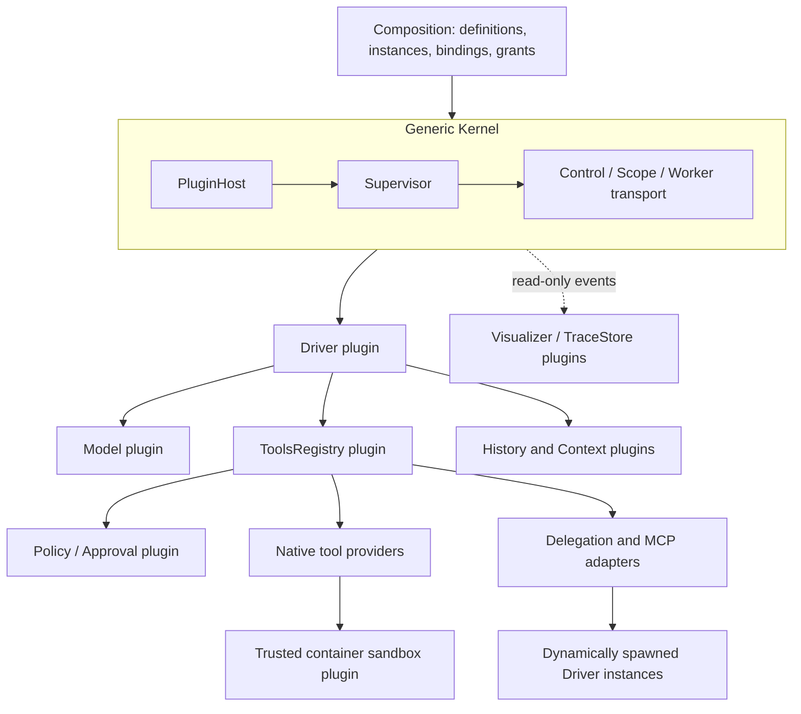

# Agent Kernel · AgentLab

A plugin kernel and local Agent workbench for interactive tasks and controlled systems experiments.

AgentLab separates **execution infrastructure** from **Agent behavior**. The Kernel loads explicit compositions, resolves capability bindings, supervises executions and scopes, and enforces process boundaries. Drivers, model providers, tools, memory, context projections, delegation, budgets, and visualization are ordinary plugins. There is no built-in planner, benchmark, skill-learning method, or model vendor in the Kernel.

## Quick start

Verified platform: Linux / WSL2, Python 3.10+, Node.js 22 for the external harness fixture, and Docker Engine for the sandbox. The reference suite uses deterministic local model fixtures and sends no paid model requests.

```bash
git clone https://github.com/YU-S3/Agent-Kernel.git
cd Agent-Kernel
python -m venv .venv
source .venv/bin/activate
pip install -e '.[dev]'
docker pull python@sha256:aa943ce411423c7582288f18707ff66eddcbaeb510502d747a72aeb34f30d159
agentlab run --profile viz-basic --report-dir runs/read-file
agentlab visual serve --profile profiles/basicagent-viz.yaml
```

Open **http://127.0.0.1:8765**. Choose **模型设置** to save an API endpoint, model name and key. The default connection targets DeepSeek's Chat Completions API. Alternatively copy `.env.example` to `.env` and set `DEEPSEEK_API_KEY`. Saving settings sends no model request. Keys stay in a local file with mode 0600 and are never returned to the browser or included in composition locks.

Choose an **Agent 配置**, select tools and an optional workspace, enter a task, and click **开始新任务**. All twelve Basic configurations share the real model connection: tool loop, single step, plan/execute, persistent memory, sandbox tools, model-selected delegation, parallel delegation, dynamic spawning, dynamic tool registration, approval, local MCP file tools, and renamed bindings. The Driver streams model output, dispatches complete tool calls through the permission registry, and returns tool results to the same conversation. **继续此会话** preserves history and accounting. Completed and interrupted sessions survive server restarts. Shell/Python require Docker and an explicit approval; they run with a read-only workspace and a separate output directory.

For a benchmark, choose **任务来源 → SearchQA**, select an imported split, and set **起始题号 / 运行题数**. The recommended configuration is **Basic · 工具循环**. SearchQA supplies task-local `search_snippets` / `read_snippet` tools and a private EM/F1 scorer. Each question gets an independent session. Task progress, answers, usage, errors and histories appear above the same live plugin graph. **本题结束后暂停** checkpoints at a task boundary; **继续剩余题目** skips settled tasks. An interrupted uncertain question is recorded as an error and is never silently resent. See [benchmark adapters and data setup](docs/benchmarks.md).

The event panel defaults to semantic events and assembled model responses; streaming fragments remain available in the raw-events view. Answer streaming continues independently. Replay batches fragments and draws once per animation tick; it does not resend requests.

The dependency preview reflects the selected tools before execution. Actual execution events animate the graph; replay reads saved events without running plugins. Closing the page does not cancel a task. The server binds loopback and rejects cross-origin mutations.

The answer pane renders Markdown and TeX in live output, saved answers and conversation history. Tool details are collapsed; **运行详情** opens the original envelope in the inspector. Rendering does not rewrite saved records. The pinned Markdown, sanitizer and math assets are shipped locally with their licenses and SHA256 manifest, so formatting needs no CDN connection.

Offline examples remain available for reproducible conformance tests and never call a commercial provider. Their fixed answers are not model-quality results. See [the workbench guide](docs/workbench.md) for setup, connection troubleshooting and the distinction between model limits and runtime policies.

## Architecture

See [Basic plugin contracts](docs/basic-plugin-contracts.md) for evidence
novelty, tool/child failure propagation, exact versus unknown usage, and
versioned local SearchQA scoring. New selections freeze their scorer;
historical results are never silently re-scored.



- `src/agentlab/`: generic Host, Supervisor, Scope, Control, transports and observation.
- `src/agentlab_plugins/`: independently bound application implementations.
- `plugins/basicagent/`: versioned plugin manifests and entry points.
- `src/agentlab_app/`: reference composition builder, CLI, HTTP UI and generic graph renderer.
- `plugins/examples/`: small Kernel contract fixtures and the external Node harness.
- `tests/`: original Kernel contracts and the new AG01–AG30 integration matrix.
- `docs/specs/`: supplied design references. `docs/basicagent-design.md` records resolved design conflicts.

The original SkillCompiler / SkillOpt application code, benchmark banks, old planner, compatibility Host, and migration tests have been removed from this distribution. The pre-refactor version remains in the separate research checkout and local archive; it is not imported, packaged, or used as acceptance evidence.

## Compose a new method or mode

1. Write an ordinary async plugin with `apply(ctx, config)` and `ctx.expose(...)`.
2. Declare its exports and exact required / optional binding slots in `plugin.json`.
3. Register its `PluginDefinition` and add an instance to a Composition. Bind only approved capabilities.
4. Select an explicit entry export; neither an Agent nor an entry named `run` is mandatory.
5. Put an `agentlab.profile.v1` YAML in `profiles/` to expose a custom Composition in the UI (see `profiles/custom-echo.yaml`). The server discovers it without any renderer or Kernel edits.
6. If a thin entry point imports another installed Python implementation, declare its package in `python_dependencies`. Actual source bytes join the definition digest.

```python
async def apply(ctx, config):
    async def execute(payload, call):
        answer = await ctx.call("service", "transform", payload, parent=call)
        return {"answer": answer}
    ctx.expose("execute", execute)
```

A learning algorithm can be an independent plugin consuming authorized traces and returning versioned assets. An alternate Agent mode is a Driver plugin. Neither requires modifying Kernel scheduling or the frontend renderer. See [plugin contracts](docs/basicagent-design.md) for scopes, tools, delegation, errors, and cancellation.

## Reference profiles

`viz-basic`, `viz-tool-sandbox`, `viz-subagent`, `viz-multi-agent`, `viz-memory`, `viz-dynamic-spawn`, `viz-dynamic-tools`, `viz-external`, `viz-random-names`, `viz-approval`, `viz-mcp`, `viz-plan-execute`, and `viz-single-step`.

The graph draws instance identifiers and actual bindings, executions and scope ownership. It has no model / planner / benchmark naming rules. Pan, pointer-centered zoom, Fit, node dragging, and playback are UI state only.

## Validation

```bash
agentlab test --suite kernel-contracts --offline --report-dir reports/kernel
# After the real browser validation described in docs/browser-validation.md:
agentlab test --suite basicagent --offline --report-dir reports/basicagent \
  --browser-evidence reports/browser/browser_validation.json
```

AG01–AG30 cover the complete reference distribution. Each case writes a manifest, lock, Kernel events, business trace, tool receipts, result, and cleanup report. Sandbox cases inspect real Docker policies and exercise prohibited filesystem/network actions, deadlines, and process-tree cleanup. AG13 consumes real browser evidence bound to the frontend source digest; missing or stale evidence fails, rather than silently skipping UI acceptance.

CI runs the independently executable contracts and integration cases. Browser interaction acceptance is a separate explicit gate; a headless backend CI pass alone is not a full-system release verdict. The optional AG31 (paid provider) and AG32 (real CC/Codex harness SDK) are not claimed by offline acceptance.

## Runtime boundaries

Trusted local plugins are trusted Python code. They are not a security boundary against malicious in-process code. Untrusted dynamic Shell/Python source runs only inside the pinned container backend with no network, read-only workspace/root, an explicit output mount, dropped capabilities, and memory/PID/CPU/time/output limits. Process workers use the generic Kernel ABI and do not inherit arbitrary credentials.

History is append-only; Context builds a projection. A session has a scoped lease, and unfinished tool calls are settled as cancelled/unknown when its owning execution closes. Registry admission and dispatch use the same authenticated scope and permission checks. Tool business errors, provider failures, and unknown transport outcomes remain distinct; side effects are not automatically replayed.

Live sessions use an accounting plugin: actual returned usage, request counts, pending requests and unknown usage are recorded separately. There is no default cumulative token cap. Optional request limits and Agent step limits are runtime policy, not model connection fields. `max_tokens` is an optional **per-response** limit; leaving it empty uses the API default. The strict reservation budget remains a separate plugin for controlled fixtures, with no claim of a guaranteed commercial-provider token cap.

Context and History are separate plugins. The current live context projection retains the system messages and recent whole turns, preserving assistant/tool pairing and the full append-only history on disk. It does not yet implement model-generated semantic summaries. Long or repeated tool results are excerpted/deduplicated only in the sending projection. Original facts and normal tool-round reasoning remain intact. The optional `agent.policy.basic` binding triggers at most one tool-free, bounded final answer on stagnation, capacity pressure or the step boundary. Required input that still cannot fit returns an explicit controlled terminal state; task text and images are never silently removed.

## License

MIT. External dependencies and container images retain their own licenses. This repository contains no API keys, paid experiment data, model-specific banks, or benchmark-specific prompts.

Connection pooling and a five-minute DNS cache are scoped to each Provider instance. A temporary DNS resolution failure may be retried twice before any HTTP request is sent, within the original request deadline. Disconnections after transmission are recorded as uncertain and are not automatically replayed. Exact usage is never fabricated.
